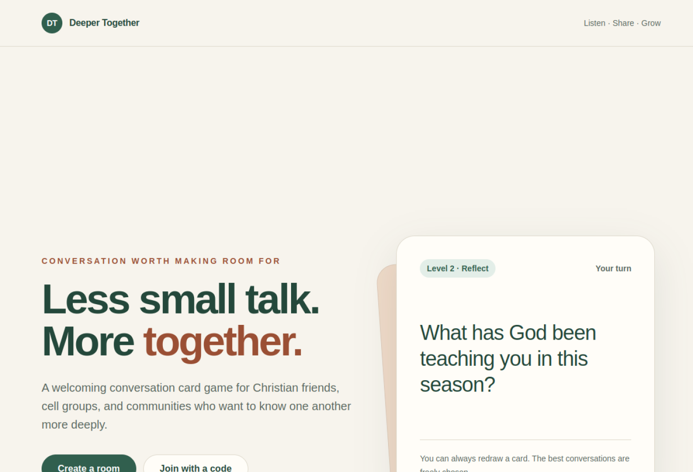
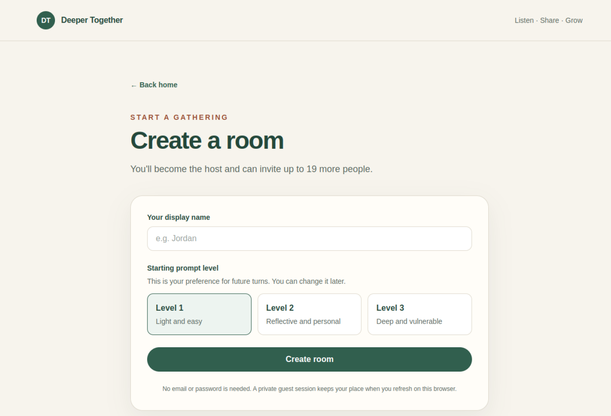

# Hi, I'm Fredrick

I'm a Computer Science undergraduate at the National University of Singapore, building full-stack applications and developer-facing software. My recent work focuses on real-time systems, secure backend design, automated testing, and dependable deployment.

I care about what happens after a prototype works: permissions, state consistency, failure recovery, test coverage, and maintainable delivery.

I'm currently open to internships.

## Engineering toolkit

| Area | Technologies used in my projects |
| --- | --- |
| Frontend | React, Next.js, TypeScript, JavaScript, Vite, Tailwind CSS |
| Backend and data | Python, FastAPI, Supabase, PostgreSQL, SQL, REST APIs |
| Testing and delivery | Playwright, pgTAP, GitHub Actions, Vercel |
| Desktop development | Java, JavaFX, Gradle |

## Featured project

### Deeper Together

A mobile-first, real-time conversation card game for small groups and communities. It is the project that best represents how I currently approach full-stack product engineering.

  

- Built with Next.js, TypeScript, Tailwind CSS, Supabase, PostgreSQL, and Vercel
- Designed server-authoritative rooms, turn progression, permissions, prompt selection, and realtime recovery
- Protected data with row-level security, least-privilege access, and server-only credentials
- Added multiplayer end-to-end tests, accessibility checks, database security tests, and continuous integration

  

[Try the live application](https://deeper-together-eta.vercel.app/)

## Other work

### Obsidian Council

A branching interactive story game created for NUS Orbital with a teammate.

- Built a React and Vite frontend with a Python and FastAPI backend
- Added persistent save and load for registered users, plus browser storage for guests
- Designed the branching story navigation and supporting game interfaces

[View the live application](https://orbital26-iota.vercel.app/)

## Connect

[LinkedIn](https://www.linkedin.com/in/fredrickcc)
